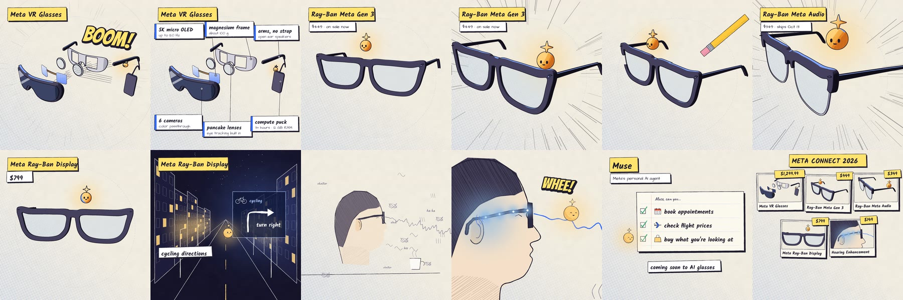

# Meta Connect 2026 recap


A one minute recap of the Meta Connect 2026 glasses announcements, drawn in a hand made sketchbook style. It covers the Meta VR Glasses, Ray-Ban Meta Gen 3, Ray-Ban Meta Audio, Meta Ray-Ban Display, Hearing Enhancement and the Muse AI agent, and ends on a price board.

Every frame and sound is made with code. There is no After Effects project and no editing timeline.



## How it works

The glasses are built as 3D models in Blender with Python (`scene3d.py`, `vr3d.py`) and each shot is rendered by its `shot*_blend.py` script.

`stylize3d.py` and `ink.py` turn the renders into drawings: ink lines, paper texture and flat marker colour, so the 3D reads as a sketch.

Each `shot*_comp.py` builds one shot with the labels, spec callouts, comic sound words like BOOM and WHEE, and the little mascot. `timeline.py` sets which frames each shot uses and where it sits in the cut, and `assemble.py` puts the whole video together.

`music.py` writes the music and `audio_mix.py` lays the sound effects on the picture's events.

## Running it

You need Python 3.11 and ffmpeg.

```
pip install -r requirements.txt
```

1. Render the 3D shots, for example `python3 shotB_blend.py -- r3d/B 1 261`. `queue.sh` shows the full order.
2. Build each shot with its comp script, for example `python3 shotB_comp.py 0 261`.
3. Put the cut together with `python3 assemble.py`.
4. Make the sound with `python3 music.py` and `python3 audio_mix.py`.
5. Encode:

```
ffmpeg -framerate 24 -i fr/ALL/%04d.png -i mix.wav -c:v libx264 -crf 18 -pix_fmt yuv420p -c:a aac -b:a 192k -shortest meta_connect_2026.mp4
```

Scripts find their files from the repo root. Set `PROJECT_ROOT` if you move things around. Rendered frames, audio and videos are not in the repo because the scripts make them.

## Built with
Python, Blender (bpy), Pillow, NumPy, SciPy, ffmpeg, and Claude (Anthropic) as coding partner.

Fonts in `fonts` come from Google Fonts under the SIL Open Font License.
